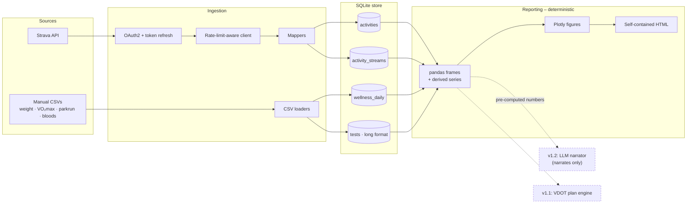

# longrun

A training tracker for running that has no finish line. Most tools are built
around a goal race and answer "am I on track for October?" – longrun is built
for training you intend to keep doing for decades, and answers "what has
actually been happening to me?"

It pulls activities from Strava (pace, heart rate, per-activity streams) and
stores them alongside the measurements that never reach a Strava activity –
resting heart rate, estimated VO₂max, weight, parkrun times, blood results.
Some of those your watch records but never syncs; the rest come from a GP, a
set of scales, or a spreadsheet. Everything lands in one local SQLite file and
comes back out as trend visualisations on a shared timeline.


*Generated from `sample_data/`, which is entirely fabricated. See
[Sample data](#sample-data).*

## The design principle

**All analysis is deterministic and computed in Python. Any future LLM layer
only ever narrates pre-computed outputs – it never invents numbers or training
plans.**

This constrains the architecture: every figure traces back to a value computed
by ordinary code from rows in the store, and the reporting layer makes no model
calls. The v1.2 narrator will receive finished numbers and phrase them, rather
than being handed the database and asked what it thinks.

For the same reason the dashboard computes **no correlation coefficients**, and
says so on the page. These metrics are monthly at best, and an r-value over a
handful of irregular points looks far more authoritative than it is.

## Architecture



Provider payloads never travel past a mapper: ingestion adapters translate
Strava JSON and CSV rows into the same few Pydantic models, so a second
provider means a new mapper rather than changes to the store or the reports.

## Data model

| Table | Holds |
|---|---|
| `activities` | One row per activity, keyed on `strava_id` |
| `activity_streams` | Per-sample series: HR, velocity, distance, altitude, cadence |
| `wellness_daily` | One row per date: resting HR, HRV, sleep, weight |
| `tests` | **Long format** – one row per `(date, metric, source)` |

`tests` being long rather than wide is the load-bearing decision. VO₂max, race
times, blood results, body composition and anything measured in future are all
rows, so tracking something new never needs a migration.

Every write is an upsert on a natural key, so re-ingesting is safe.
`wellness_daily` merges with `COALESCE`, so a CSV carrying only weight cannot
erase a resting HR that came from a different export.

### Why parkrun rather than any 5k

`parkrun_5k` is kept as its own metric because it is a fixed, measured course
run under roughly comparable conditions, which makes the series comparable
across years. Folding every 5k into one line would mix a hard solo effort, a
treadmill run and a parkrun together and flatten the trend.

Nothing here is parkrun-only. The long format means `5k`, `10k` or anything
else is simply another metric name – add rows and it is tracked. Only the
dashboard's dedicated panel is parkrun-specific.

## Setup

Requires Python 3.12 and [uv](https://docs.astral.sh/uv/).

```bash
git clone git@github.com:annabator/longrun.git
cd longrun
uv sync
uv run pre-commit install
```

### Registering a Strava API application

1. Go to <https://www.strava.com/settings/api> and create an application.
2. Set **Authorization Callback Domain** to `localhost`.
3. Copy the **Client ID** and **Client Secret**.
4. `cp .env.example .env`, then fill in `STRAVA_CLIENT_ID` and
   `STRAVA_CLIENT_SECRET`.
5. Authorise once:

   ```bash
   uv run longrun auth strava
   ```

   This prints a URL to approve. You are then redirected to an address
   containing `code=...`; the page itself may fail to load, which is expected –
   only the address bar matters. Paste the code value into the prompt. Tokens
   are cached with owner-only permissions and refreshed silently from then on.

## Usage

```bash
# Pull activities and their streams. Resumes from the latest stored activity.
uv run longrun ingest strava

# A cautious first run
uv run longrun ingest strava --limit 10 --no-streams

# Backfill history from spreadsheets
uv run longrun ingest manual --wellness my_wellness.csv
uv run longrun ingest manual --tests my_results.csv

# Build the dashboard
uv run longrun report --output report.html
```

Use `--db path/to.db` to work against a different store.

### CSV formats

`--wellness` – only `date` is required; blank cells mean "not recorded":

```csv
date,resting_hr,hrv,sleep_hours,sleep_score,weight_kg,source,notes
2026-01-06,48,61,7.5,84,61.2,watch,
2026-01-07,47,64,8.1,88,,watch,
```

`--tests` – long format; `date`, `metric` and `value` are required:

```csv
date,metric,value,unit,source,notes
2026-01-04,parkrun_5k,22:47,,parkrun,windy
2026-01-06,vo2max,52.1,ml/kg/min,watch,
2026-02-11,vitamin_d,62,nmol/L,gp,
```

Two conveniences, both deliberate:

- **Durations may be written as recorded.** `22:47` becomes 1367 seconds with
  the unit set to `s`, which is what lets personal bests compare correctly.
  `1:29:04` works too.
- **Dates must be ISO-8601** (`YYYY-MM-DD`). `03/04/2026` is rejected rather
  than guessed at, because a misread date silently bends a trend line.

Metric **names** are trimmed and lower-cased, so `VO2max` and `vo2max` stay one
series rather than becoming two. Values and units are stored exactly as given.

## Sample data

`sample_data/` holds a fabricated eighteen-month history: daily resting HR and
sleep, monthly weight and VO₂max, fortnightly parkruns, occasional blood
results, and 253 activities. A seeded generator produces it, so its provenance
is checkable rather than asserted:

```bash
uv run python scripts/generate_sample_data.py   # regenerate (byte-identical)
uv run python scripts/build_demo_report.py      # build the demo dashboard
```

This is what the test suite and the screenshot above run on. No real training
history is in this repository.

## Privacy

- `data/`, all databases, `.env` and token files are gitignored, and a
  pre-commit hook fails if one is ever staged.
- Only `.env.example`, holding placeholders, is committed.
- Credentials are held as `SecretStr`, so a stray log line cannot leak them.
- The dashboard inlines Plotly rather than loading it from a CDN, so opening a
  page of personal health data makes no outbound request. A test asserts this.

## Development

```bash
uv run ruff check .      # lint
uv run ruff format .     # format
uv run mypy              # strict type checking
uv run pytest            # tests
```

Type hints throughout, docstrings on public functions, `mypy --strict` clean.

## Roadmap

- **v1.0 – this release.** Ingestion, storage, trend visualisations.
- **v1.1 – VDOT plan engine.** Derive VDOT from parkrun and race efforts, and
  generate training paces and week structures. Deterministic, computed in
  Python; the `analysis` package is reserved for it.
- **v1.2 – LLM weekly narrative.** A short written summary of the week, phrasing
  figures already computed by v1.0 and v1.1. It does not see the database, and
  it does not produce numbers or plans.

## Licence

MIT – see [LICENSE](LICENSE).
