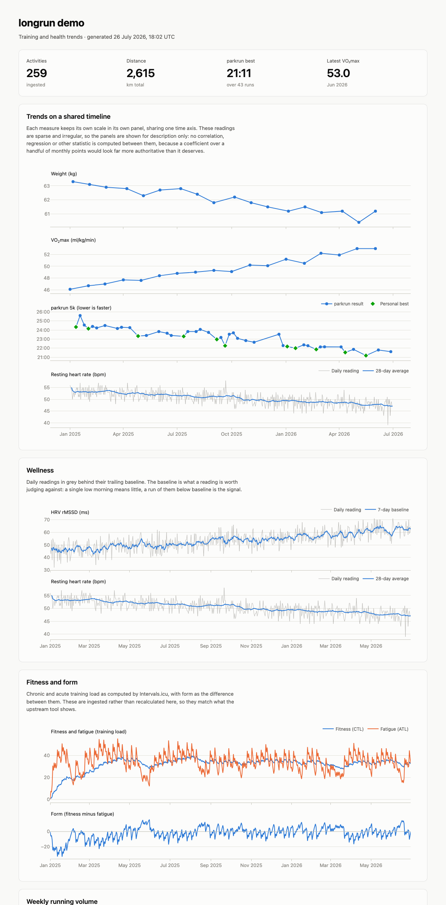
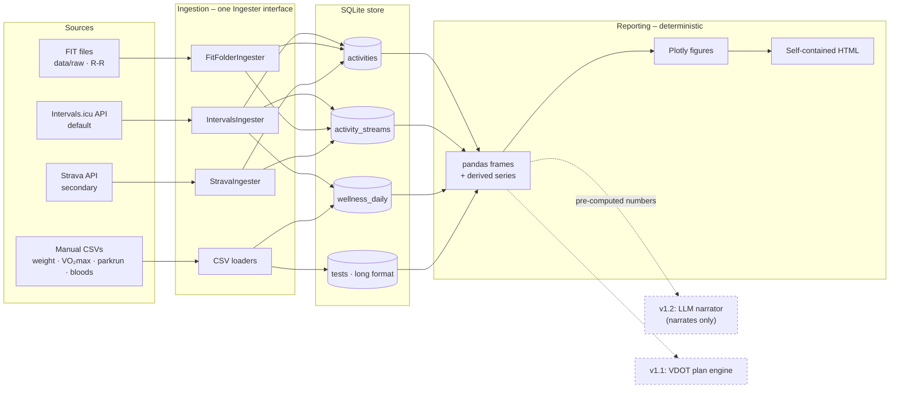

# longrun

A training tracker for running that has no finish line. Most tools are built
around a goal race and answer "am I on track for October?" – longrun is built
for training you intend to keep doing for decades, and answers "what has
actually been happening to me?"

It pulls activities from Intervals.icu (pace, heart rate, per-activity
streams, plus how the session felt and what it cost) and stores them alongside
the measurements that never reach an activity file – resting heart rate, HRV,
sleep, estimated VO₂max, weight, parkrun times, blood results. Some of those
your watch records but never syncs; the rest come from a GP, a set of scales,
or a spreadsheet. Everything lands in one local SQLite file and comes back out
as trend visualisations on a shared timeline.



*Generated from `sample_data/`, which is entirely fabricated. See
[Sample data](#sample-data).*

## Cheat sheet

Everything below is a normal terminal command run from the project folder.
Nothing runs in the background and nothing is a daemon: you type a command,
it does one thing, it stops.

```bash
# Every so often - pull new activities and wellness from Intervals.icu
uv run longrun ingest intervals

# Log something by hand, one reading at a time
uv run longrun log weight 74.2
uv run longrun log vo2max 45
uv run longrun log parkrun_5k 29:25 --date 2026-07-25

# See where you are
uv run longrun plan            # what is worth doing this week
uv run longrun plan --today    # just the next thing
uv run longrun readiness       # green / amber / red, with the reasoning
uv run longrun anchor          # current training paces

# Build the dashboard, then open it
uv run longrun report
open data/report.html

# Narrow every panel to the same window, so sparse and dense series line up
uv run longrun report --since 2025-12-01
```

`longrun report` writes `data/report.html`. It is a normal web page: open it,
bookmark it, rebuild it whenever. Nothing is served and nothing is uploaded.

Optional, if you track it: `longrun cycle log 2026-07-25` records a period
day, and `longrun report --with-cycle` adds a panel for it. That data lives in
a separate file and never appears in a report unless you ask for it.

Add `--help` to any command to see its options.

## The design principle

**All analysis is deterministic and computed in Python. Any future LLM layer
only ever narrates pre-computed outputs – it never invents numbers or training
plans.**

This constrains the architecture: every figure traces back to a value computed
by ordinary code from rows in the store, and the reporting layer makes no model
calls. The v1.2 narrator will receive finished numbers and phrase them, rather
than being handed the database and asked what it thinks.

For the same reason the dashboard computes **no correlation coefficients**, and
says so on the page. These metrics are monthly at best, and an r-value over a
handful of irregular points looks far more authoritative than it is.

## Architecture



Provider payloads never travel past a mapper: every adapter satisfies one
`Ingester` interface and translates its source into the same few Pydantic
models, so adding a source means adding an adapter rather than changing the
store or the reports.

## Data model

| Table | Holds |
|---|---|
| `activities` | One row per activity, keyed on `(source, external_id)`; includes `feel`, `rpe`, `icu_load`, `icu_intensity` |
| `activity_streams` | Per-sample series: HR, velocity, distance, altitude, cadence, `rr_ms` |
| `wellness_daily` | One row per date: resting HR, sleeping HR, HRV rMSSD, sleep, SpO₂, weight |
| `tests` | **Long format** – one row per `(date, metric, source)` |

`tests` being long rather than wide is the load-bearing decision. VO₂max, race
times, blood results, body composition and anything measured in future are all
rows, so tracking something new never needs a migration.

Activities are keyed on `(source, external_id)` rather than one provider's id,
so the same session seen by two sources stays two rows and neither can
overwrite the other.

Every write is an upsert on a natural key, so re-ingesting is safe.
`wellness_daily` merges with `COALESCE`, so a CSV carrying only weight cannot
erase a resting HR that came from a different export.

### What comes from where

| | Intervals.icu | FIT files | Manual CSV |
|---|---|---|---|
| Activities + streams | ✅ | ✅ | – |
| feel / RPE / per-activity load | ✅ | – | – |
| Daily wellness (HRV, RHR, sleep, SpO₂) | ✅ | – | ✅ |
| Beat-to-beat R-R | ✅ with `--rr` | ✅ | – |
| Weight, VO₂max, bloods, parkrun | – | – | ✅ |

Two things Intervals.icu returns are deliberately not stored:

- **CTL, ATL and form** — exponentially weighted averages over a load that is
  itself modelled. This project prefers the measured series they derive from.
  Per-activity `icu_load` is kept, and Intervals.icu remains the place to read
  the rolling versions.
- **Weight** — Intervals repeats the figure entered once at sign-up on every
  daily record, so it is a profile setting rather than a measurement.
  Ingesting it would draw a flat line through the weight trend and, because
  wellness merges field by field, would overwrite a weight entered by hand.
  **Weight comes from a CSV only.**

R-R intervals are not in the Intervals.icu streams API, so `--rr` downloads
each activity's file and reads the beats out of it: the original upload first,
since it is what the watch actually wrote, falling back to the
Intervals-generated FIT for activities uploaded as GPX or TCX. It is **off by
default** — it is the largest request the adapter makes and nothing consumes
the data yet — but the path is kept working for per-beat analysis later.
`ingest fit` handles files from anywhere else.

VO₂max is source-dependent: some watches estimate it and pass it through,
others never produce one. longrun does not assume it exists – if your watch
supplies it, ingest it; if not, log it by CSV like any other measurement.

### Why parkrun rather than any 5k

`parkrun_5k` is kept as its own metric because it is a fixed, measured course
run under roughly comparable conditions, which makes the series comparable
across years. Folding every 5k into one line would mix a hard solo effort, a
treadmill run and a parkrun together and flatten the trend.

Nothing here is parkrun-only. The long format means `5k`, `10k` or anything
else is simply another metric name – add rows and it is tracked. Only the
dashboard's dedicated panel is parkrun-specific.

## Setup

Requires Python 3.12 and [uv](https://docs.astral.sh/uv/).

```bash
git clone git@github.com:annabator/longrun.git
cd longrun
uv sync
uv run pre-commit install
```

### Connecting Intervals.icu

1. Open <https://intervals.icu/settings> and find your **Athlete ID** and
   **API Key**.
2. `cp .env.example .env`, then fill in `INTERVALS_ATHLETE_ID` and
   `INTERVALS_API_KEY`.

There is no OAuth dance: the key is used as an HTTP basic password with the
literal username `API_KEY`.

### Connecting Strava (optional)

Strava now requires a paid subscription for the endpoints longrun uses, which
is why Intervals.icu is the default. If you have one, register an application
at <https://www.strava.com/settings/api>, set the callback domain to
`localhost`, put the client id and secret in `.env`, then run
`uv run longrun auth strava` once and paste back the `code=...` value from the
redirect. Tokens are cached with owner-only permissions and refreshed silently
from then on.

## Usage

```bash
# The default: activities, streams and daily wellness. Incremental and safe
# to repeat.
uv run longrun ingest intervals

# A cautious first run
uv run longrun ingest intervals --limit 10 --no-streams

# Also download each activity file for beat-to-beat R-R intervals
uv run longrun ingest intervals --rr

# Parse FIT exports sitting in data/raw, for files from anywhere else
uv run longrun ingest fit

# Backfill history from spreadsheets
uv run longrun ingest manual --wellness my_wellness.csv
uv run longrun ingest manual --tests my_results.csv

# Build the dashboard
uv run longrun report --output report.html
```

Use `--db path/to.db` to work against a different store.

### CSV formats

`--wellness` – only `date` is required; blank cells mean "not recorded".
Weight usually lives here, since Intervals.icu only carries it if something
syncs it in:

```csv
date,resting_hr,hrv_rmssd,sleep_hours,sleep_score,weight_kg,source,notes
2026-01-06,48,61,7.5,84,61.2,watch,
2026-01-07,47,64,8.1,88,,watch,
```

`hrv` is still accepted as a synonym for `hrv_rmssd`, so spreadsheets written
against v1.0 keep loading unchanged.

`--tests` – long format; `date`, `metric` and `value` are required:

```csv
date,metric,value,unit,source,notes
2026-01-04,parkrun_5k,22:47,,parkrun,windy
2026-01-06,vo2max,52.1,ml/kg/min,watch,
2026-02-11,vitamin_d,62,nmol/L,gp,
```

Two conveniences, both deliberate:

- **Durations may be written as recorded.** `22:47` becomes 1367 seconds with
  the unit set to `s`, which is what lets personal bests compare correctly.
  `1:29:04` works too.
- **Dates must be ISO-8601** (`YYYY-MM-DD`). `03/04/2026` is rejected rather
  than guessed at, because a misread date silently bends a trend line.

Metric **names** are trimmed and lower-cased, so `VO2max` and `vo2max` stay one
series rather than becoming two. Values and units are stored exactly as given.

## Sample data

`sample_data/` holds a fabricated eighteen-month history: daily resting HR,
HRV, sleep and SpO₂, monthly weight and VO₂max, fortnightly parkruns,
occasional blood results, and 259 activities. A seeded generator produces it,
so its provenance is checkable rather than asserted:

```bash
uv run python scripts/generate_sample_data.py   # regenerate (byte-identical)
uv run python scripts/build_demo_report.py      # build the demo dashboard
```

This is what the test suite and the screenshot above run on. No real training
history is in this repository.

## Training plan

An adaptive weekly menu, built from rules rather than a model.

```bash
uv run longrun goals --emphasis threshold --runs 4 --quality 2
uv run longrun anchor        # training paces from the best recent 5k
uv run longrun readiness     # green/amber/red, with the reasoning
uv run longrun plan          # what is worth doing this week
uv run longrun plan --today  # just the next thing
```

**Paces come from published formulas, not copyrighted tables.** VDOT is solved
from Daniels and Gilbert's oxygen-cost and drop-dead curves, and equivalent
distances from Riegel's endurance formula. The numbers land on the familiar
ones because they share the same source relationships — nothing was copied.
The anchor takes the *best* result in a four-month window, so one slow
morning cannot drop every training pace.

### Finding the parkrun

A watch names everything "Morning Run", so the name carries no signal. Instead
`anchor` scans each recent run's distance stream for its **fastest continuous
5 km**. That handles the common case of starting the watch before the start
line and carrying on afterwards: the jog falls outside the winning window.
It also removes a whole class of error — a split is exactly 5000 m by
construction, so no GPS over-read has to be normalised away and no
measurement artifact can flatter the result.

An easy jog must never set race paces, so a split only counts when its mean
heart rate reaches **92% of the athlete's own peak** (the 95th percentile of
per-run `max_hr`, which ignores the cadence-lock spikes optical sensors
produce). With too little history to calibrate that, or with no heart rate on
the effort, detection stays off rather than guessing.

**A logged parkrun always wins.** The course is fixed and measured and the
result was confirmed by a person; a detected effort is inferred from a GPS
trace and could be a net-downhill route or an over-reading watch. Detection
fills the gap when nothing is logged — it never competes on speed.

```bash
uv run longrun anchor --candidates   # what was found, and what counted as hard
```

Known limits, all real: a treadmill's distance is whatever the belt claims;
a net-downhill route flatters; a hard interval session can contain a fast 5 km;
and detection needs streams, so a run ingested with `--no-streams` is
invisible to it.

**Readiness** compares this morning's rMSSD against a rolling seven-day
baseline of its logarithm, with a normal range built from the recent standard
deviation. A single low reading is noise and is reported as such; it takes
several signals agreeing — HRV plus an elevated resting heart rate or poor
sleep — before the verdict moves. Every verdict lists what fired.

It rests on the measured signals. **Nothing asks you to rate a session**: RPE
is never required, and a post-session feel is used only where a watch happened
to record one. A full verdict is reachable from HRV, resting heart rate and
sleep alone.

**The menu is not a schedule.** It is a prioritised list of what is worth
doing this week. Nothing is assigned to a day, nothing is late, and anything
undone rolls over — up to a cap, because a fortnight of illness should not
become a fortnight of debt. Readiness attaches a note to hard sessions; it
never removes them. Easy runs are never carried forward.

**Session lengths are read off recent running, not off a percentage.** The
usual rule — a long run is 25–30% of weekly volume — falls apart at low
mileage, where it prescribes a "long run" shorter than every run actually
done. So an easy run is the median of the last eight weeks of running, and a
long run goes just past the longest of them, with a floor keeping the two
recognisably different sessions. A quality session is sized around its reps
plus a warm-up and cool-down. Easy and long runs also carry a time, since
that is how they are really judged; rep sessions do not, since a total time
for one would only mislead. Under four recent runs nothing is suggested,
which is the honest answer for someone starting out. Rides and gym sessions
are excluded, so a long ride cannot inflate a run.

**Adaptation suggests, it does not adjust.** Running quicker than prescribed
*at a lower heart rate* across several sessions means the anchor looks stale,
so it suggests a re-test. A VDOT that crept upward on its own would eventually
prescribe paces nobody can hit, with no explanation of why.

## Cycle tracking (optional)

Period days can be logged manually and used to place training and wellness
readings on the cycle day they fell on.

```bash
uv run longrun cycle log 2026-01-05 --days 5   # log a period
uv run longrun cycle today                     # where today sits, and how sure
uv run longrun cycle list                      # cycles derived from the log
uv run longrun report --with-cycle             # dashboard including the panel
```

This is the most sensitive data here, and it is isolated accordingly:

- **Its own database**, `data/private/cycle.db`, created `0700`/`0600`. The
  main store can be copied or shared without this travelling with it.
- **Manual entry only.** No adapter writes here, nothing in these modules can
  reach a network, and there is no export command. A test asserts it.
- **Never committable.** Gitignored by three separate rules, blocked by a
  pre-commit hook, and a test fails if any of those rules stops matching.
- **Opt-in on the dashboard.** Without `--with-cycle` the report contains no
  trace of it, so an ordinary report stays safe to show someone.

Only the logged days are stored. Cycle day and phase are computed at read time
and never written down, and every phase is reported as an estimate with the
reason it should or should not be trusted. Ovulation is inferred by counting
back from the next period, so a completed cycle can be described far better
than the one in progress — which the output says, rather than hiding.

## Privacy

- `data/`, all databases, `.env` and token files are gitignored, and a
  pre-commit hook fails if one is ever staged.
- Only `.env.example`, holding placeholders, is committed.
- Credentials are held as `SecretStr`, so a stray log line cannot leak them.
- The dashboard inlines Plotly rather than loading it from a CDN, so opening a
  page of personal health data makes no outbound request. A test asserts this.

## Development

```bash
uv run ruff check .      # lint
uv run ruff format .     # format
uv run mypy              # strict type checking
uv run pytest            # tests
```

Type hints throughout, docstrings on public functions, `mypy --strict` clean.

## Roadmap

- **v1.0.** Ingestion, storage, trend visualisations.
- **v1.1.** Intervals.icu as the default source, daily wellness panels,
  optional cycle tracking, and the plan engine above: VDOT anchor, readiness,
  per-run fitness measures, block rotation, weekly menu and adaptation. All
  deterministic and computed in Python, all in `longrun.analysis`.
- **v1.2 – LLM weekly narrative.** A short written summary of the week, phrasing
  figures already computed by v1.0 and v1.1. It does not see the database, and
  it does not produce numbers or plans.

## Licence

MIT – see [LICENSE](LICENSE).
